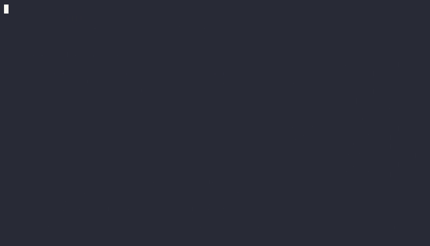

# 🌸 ototunetake (音連影)

> **Dedicated Japanese Shadowing & Continuous Listening Player Powered Directly by Your Reviewed Anki Collection.**

[](https://www.rust-lang.org/)
[](LICENSE)
[](https://ratatui.rs/)
[](https://apps.ankiweb.net/)
[](https://github.com/RustAudio/rodio)

---

<div align="center">
  
</div>

---

```text
┌────────────────────────────────────────────────────────────────────────┐
│  🌸 Ototunetake ── Japanese Shadowing Player                           │
│  Status: [ 🗣 SHADOWING ]  [SHADOW]   Rep 1/2  •  Gap: 1.2s  •  Vol: 100%│
│  Sentence 12 of 756 (All Reviewed)  │  Today: 42 sent (28m, 84 reps)   │
├────────────────────────────────────────┬───────────────────────────────┤
│ 🎧 Japanese Shadowing Player           │ 📋 Queue  [SEQUENTIAL]        │
│                                        │                               │
│       平仮名が分かります。                │ ▶  12. 平仮名が分かります。       │
│      [ひらがながわかります。]             │    13. 私は猫が大好きです。     │
│  I know hiragana. I understand hiragana│    14. 明日は休みだよ。        │
│                                        │    15. コーヒーを飲みます。     │
│ [====================================] │    16. 映画を見に行きました。   │
│       🗣 Shadow Along: 0.8s / 1.6s     │    17. これはいくらですか？    │
│                                        │    18. 駅はどこですか？        │
│  Mode [m]: SHADOW (Concurrent Shadow)  │    19. 日本語を勉強しています。 │
│  Reps: 2x [keys 1-5] │ Gap: 1.2s [[/]] │    20. 今日は天気がいいね。    │
│  Deck: Ankidrone V7  │ Tags: jp1k      │                               │
│  Status: Mature (49d)│ Reps: 14        │                               │
├────────────────────────────────────────┴───────────────────────────────┤
│ [Space] Play  [1-5] Reps  [m] Mode  [[/]] Gap  [a] Auto-Adv  [t] Text   │
│ [n/p] Nav  [r] Replay  [s] Shuffle  [P] Playlists  [/] Search  [?] Help │
└────────────────────────────────────────────────────────────────────────┘
```

**`ototunetake`** (音連影) is a fast, keyboard-driven terminal audio player built for Japanese shadowing and ear immersion. Inspired by the workflow and aesthetic of [**ototune**](https://github.com/Praveensenpai/ototune), it transforms sentences you have **already encountered and reviewed in Anki** into an immediate, friction-free shadowing gym.

It **never** regenerates, downloads, scrapes, or synthesizes audio. It discovers and plays the exact native audio files already sitting inside your local Anki collection, in strict read-only mode, without touching your review scheduling, intervals, or ease factors.

---

## 🎯 Why Ototunetake? (Anki vs Ototunetake)

| Traditional Anki Review | Ototunetake Shadowing Player |
| :--- | :--- |
| **Testing Memory & Recall**: You rate how well you remembered a card (Again / Hard / Good / Easy). | **Muscle Memory & Pronunciation**: You shadow native pitch, intonation, and rhythm until it becomes second nature. |
| **Stop-and-Go Friction**: You click "Show Answer", listen once, click a button, and wait for the next card. | **Seamless Continuous Flow**: Continuous audio-first playback with structured repetition loops and zero manual clicking. |
| **Reading-First Bias**: Your eyes naturally gravitate towards the kanji/text before your ears parse the audio. | **Audio-First Immersion**: Text is hidden by default (`t` to reveal), forcing your brain to comprehend ear-first. |
| **Rigid Scheduling**: Opening Anki when you only have 5 minutes feels like starting a test. | **Zero Pressure Practice**: Open terminal $\to$ press Space $\to$ continuous shadowing tape while cooking, walking, or commuting. |

---

## 🔁 The 3 Practice Modes

Switch between modes anytime by pressing **`m`** (or `Tab`):

### 1. `SHADOW` Mode (Default & Authentic Shadowing)
The gold standard for muscle memory, pitch accent, and pronunciation:
```text
Native Audio (You Shadow Concurrently) ──► Breathing Gap (1.2s) ──► Repeat N times ──► Card Complete Break (2.0s) ──► Auto-Advance
```
1. **Concurrent Shadowing**: The native reference audio plays, and you speak simultaneously with a 0.2s–0.5s lag behind the speaker.
2. **Breathing Gap**: A brief 1.2s vocal reset pause before repetition 2, 3, etc.
3. **Card Complete Break**: After all repetitions for the card finish, a 2.0s calming reset break allows your brain to digest the sentence before the next card loads.

### 2. `ECHO` Mode (Call & Response / Repeat After Me)
Ideal for memory retrieval and verifying pronunciation:
```text
Native Audio (Listen) ──► Speaking Gap (Repeat Aloud) ──► Replay Check (Self-Correction) ──► Breathing Gap (1.0s) ──► Repeat N times ──► Auto-Advance
```
1. **Listen**: Hear the sentence once from the native speaker.
2. **Speaking Gap**: A full silence gap (sentence length, $\ge 2.5$s) where the gauge says `🗣 Your Turn (Echo)` to reproduce the sentence from memory.
3. **Replay Check**: Native audio plays once more to verify your recall and pitch against the speaker.
4. **Breathing Gap**: 1.0s pause before the next repetition or card.

### 3. `LISTEN` Mode (Continuous Immersion)
Pure continuous native audio stream across sentences with natural spacing:
```text
Sentence 1 ──► Natural Spacing Gap (1.2s) ──► Sentence 2 ──► Natural Spacing Gap (1.2s) ──► Sentence 3 ...
```
Ideal for background immersion, passive listening, walking, or resting your voice without sentences colliding abruptly.

---

## 🎛️ Interactive Controls & Shortcuts

The on-screen player card and footer show your live settings at a glance:

- **Repetition Count (`1` – `5`)**:
  Press numbers `1`, `2`, `3`, `4`, or `5` to change how many times each sentence is practiced before advancing.
- **Breathing & Rest Gaps (`[` and `]`)**:
  Press `[` to decrease or `]` to increase the active breathing/rest gap by `0.2s` on the fly.
- **Card Complete Break (Automatic)**:
  After completing all configured repetitions of a card, a 2.0s gold status break (`🎉 Card Complete`) provides cognitive reset before loading the next card.
- **Auto-Advance Toggle (`a`)**:
  - When **ON**, the player automatically transitions to the next sentence when repetitions finish.
  - When **OFF**, the player pauses after the current sentence so you can practice at your own pace.
- **Audio-First Text Toggles (`t`, `f`, `e`)**:
  - Press `t` to toggle the Japanese sentence text.
  - Press `f` to toggle Furigana readings.
  - Press `e` to toggle English translations.
- **Instant Playlist Filtering (`P`)**:
  Press `P` to choose from **All Reviewed**, **Mature** ($\ge 21\text{d}$), **Young** ($< 21\text{d}$), **Recently Reviewed**, or filter by specific **Deck** or **Tag**.
- **Live Fuzzy Search (`/`)**:
  Press `/` to instantly search across all sentence texts, readings, translations, and tags.

---

## ⚡ Features

### 🎧 Audio & Playback
- 🗣️ **Structured Shadowing Loop**: Reference Audio $\longrightarrow$ Configurable Silence Gap $\longrightarrow$ Reference Replay $\longrightarrow$ Repetition Loop $\longrightarrow$ Auto-Advance.
- 🎵 **Opus & OGG Fallback Engine**: Probes exact audio durations via `ffprobe` and decodes Anki's `.ogg` Opus audio streams losslessly via native streaming FLAC fallback.
- 🔀 **Shuffle & Navigation**: Jump between sentences (`n`/`p`), replay anytime (`r`), and shuffle queue (`s`).

### 📦 Seamless Anki Integration
- 🛡️ **Zero-Mutation Read-Only**: Connects to `collection.anki2` strictly in read-only mode (`?mode=ro`). Does not alter ease, intervals, card states, or templates.
- 🔍 **Dynamic Schema Introspection**: Handles custom SQLite collations (`unicase`), auto-detects sentence text vs vocab fields, and resolves `[sound:...]` paths in `collection.media/`.
- 🏷️ **Smart Playlists**: Filter instantly by learning status, deck, or tag.

### 📊 Practice Stats & State Persistence
- 💾 **Session Resume**: Automatically saves active playlist, queue position, volume, and shuffle preference to `~/.config/ototunetake/session.json`.
- 📈 **Application-Level Stats**: Tracks sentences shadowed, daily repetition totals, and cumulative listening hours in `~/.config/ototunetake/stats.json` without modifying Anki history.

---

## 🚀 Installation

### 🪄 One-Liner (Recommended)

```bash
curl -sSL https://raw.githubusercontent.com/Praveensenpai/ototunetake/main/install.sh | bash
```

### 📦 Cargo Install

```bash
cargo install --path . --root ~/.local
```

### 🛠️ Building From Source

```bash
git clone https://github.com/Praveensenpai/ototunetake.git
cd ototunetake
cargo build --release
install -m 755 target/release/ototunetake ~/.local/bin/ototunetake
```

---

## ⌨️ Complete Keybindings

| Key | Action |
| :--- | :--- |
| `Space` | Play / Pause audio & active loop |
| `1` – `5` | Set repetitions per sentence (1x to 5x) |
| `m` / `Tab` | Cycle playback mode (`[Shadow]` $\to$ `[Listen]` $\to$ `[Repeat]`) |
| `a` | Toggle Auto-Advance on / off |
| `t` | Toggle Japanese sentence text visibility (Audio-First Mode) |
| `f` | Toggle Furigana reading display |
| `e` | Toggle English translation display |
| `n` / `Right` | Skip to next sentence |
| `p` / `Left` | Return to previous sentence |
| `r` | Replay current sentence reference audio |
| `s` | Toggle Shuffle / Sequential playback |
| `+` / `-` | Increase / decrease volume |
| `P` | Open Playlist selection modal |
| `/` | Instant live sentence search |
| `?` | Show interactive help modal |
| `q` / `Ctrl+C` | Save session state and exit |

---

## 📖 CLI Options

```bash
# Launch player with auto-discovered Anki collection
ototunetake

# Launch directly into Listen or Repeat mode
ototunetake --mode listen

# Filter only mature cards
ototunetake --mature

# Filter by deck or tag
ototunetake --deck "Japanese::Sentences" --tag "sentence-mining"

# Launch in shuffle mode with Japanese text visible by default
ototunetake -s --show-text

# Specify custom Anki collection database and media directories
ototunetake -c ~/.local/share/Anki2/User\ 1/collection.anki2 -m ~/.local/share/Anki2/User\ 1/collection.media
```

---

## 📄 License

MIT License © [Praveen Senpai](https://github.com/Praveensenpai)
